<h3><code>hector@github ~ $ whoami</code></h3>

<table>
<tr>
<td>

</td>
<td>

</td>
</tr>
</table>

 

<h3><code>hector@github ~ $ ./contributions.sh</code></h3>

 

<h3><code>hector@github ~ $ ./links.sh</code></h3>

<b>Embedded Systems Developer · C Programmer · AI Enthusiast</b>

